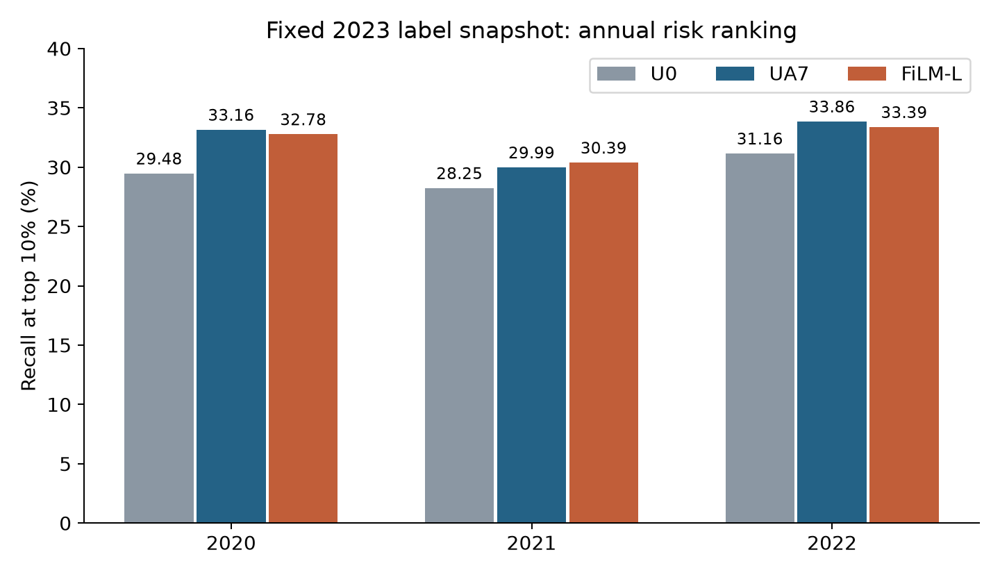
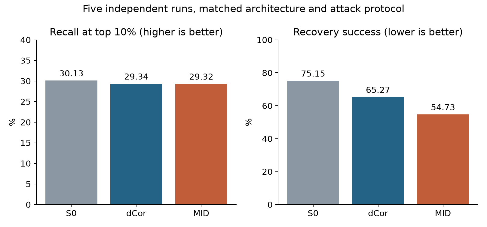

# 分节点企业违规风险排序：一次本科研究的结果、限制与弯路

Distributed corporate risk screening — a research archive, including negative results.

这个仓库来自一个本科生创新训练项目。我们原本希望利用市场、财务、治理和审计信息，在原始字段保留本地的条件下，提高企业违规风险识别能力。项目中做了许多文献阅读、数据核查和模型尝试，也多次发现：看起来合理的设计，换一年或换一个随机种子后就不再有收益。

中期评选结束，项目未获得国家级推荐，此次结果为市级层次。这个结果让我遗憾，但它也促使我重新整理：究竟完成了什么，哪些判断说早了，后来的人怎样少走一些弯路。

项目使用AI辅助文献整理、部分代码实现、实验组织与文稿整理。它降低了实现成本，也暴露出我们在假设未想清时就继续试验的问题，详见研究复盘。

这里不把每次失败都包装成发现，也不把已有模块的组合写成全新算法。我们希望留下能检查的结果、没有通过的假设，以及实验组织中的教训。中期评选结果是项目经历，不是对方法科学价值的检验。

## 研究问题

对企业年度数据评分，在固定核查预算下形成优先名单，并提供两项违规类型线索。主要指标是Recall@10%及名单精确率，不是总体分类准确率。

数据来自学校订购的CSMAR。公开数据被组织为三个节点，验证分节点计算条件。它不能证明现实上市公司公开字段本身必须隔离；真正的机构协作还涉及内部字段、权限及业务需求。本项目没有真实机构部署或非上市公司迁移验证。

## 最终做了什么

- **FiLM-L**：市场、财务、治理本地编码，审计类别调节财务潜在表示，再融合预测。FiLM为已有方法，本项目进行场景适配。
- **通信**：固定预测器，在81种消息精度组合中，按名单、Top2集合及误差条件选择配置。
- **隐私**：同架构比较无防护、dCor与随机信息瓶颈MID，重新训练攻击器评价财务恢复与属性推断。
- **维护**：新通报修正旧标签，冻结编码器进行微调与历史回放；监测退化时评估全量重训，失败保留旧版。

这些是分别评价的研究组件，不能把它们各自最好的数字拼成一个已经部署的系统。

## 哪些结果站得住

|评价年|样本数|记录正例|前10%名单|命中正例|召回率|名单精确率|
|---|---:|---:|---:|---:|---:|---:|
|2020|4292|787|430|258|32.78%|60.00%|
|2021|4794|747|480|227|30.39%|47.29%|
|2022|5199|629|520|210|33.39%|40.38%|

主结果使用截至2023-12-31的固定违规记录，是发生年度的历史回顾评价。六模型校准logit平均，不是六个概率平均。不能写成历史当时可见标签下已实现的实时预警。

- 普通审计接入UA7相对无审计U0，三年平均召回 **+2.71个百分点**。这是新增信息的收益。
- FiLM-L相对UA7平均 **−0.15个百分点**，95%差异区间跨零，没有建立稳定结构精度优势；与集中式网络的2020—2021年平均点值接近，不是统计等价性证明。
- 同一六模型预测消息 **3205 → 899 B/企业（−71.95%）**，三年名单与名单内Top2集合保持。它不是全训练通信降幅，也不是相对集中式网络的总成本比较。
- 同架构五次训练的MID财务恢复成功率 **75.2% → 54.7%**，平均召回 **30.13% → 29.32%**。字段容差为训练期标准差的0.319倍。仍有泄露，不构成差分隐私保证。
- 条件年度更新的本地累计计算耗时 **8.70秒 vs 全量16.65秒**。部分年度精度较低，不能说增量更新始终不损失效果。





## 我们没有做到什么

没有获得可稳定复现、明显优于普通融合的经济结构算法贡献。审计调节尚未证明能减少过拟合。没有证明经济分组普遍优于普通压缩。类型提示仍偏常见类别：条件Top2为87.26%，固定常见两类参照已有86.24%，十类端到端宏覆盖为6.78%。没有真实机构安全验收、政府采用或企业试用成果。

反复在相同开发年份上尝试，也使后验选型偏差成为解释限制。跨年验证不能自动消除选择过程带来的全部偏差。

## 如果你准备做类似题目

先读[研究复盘](docs/RETROSPECTIVE.md)，再看[探索记录](docs/EXPERIMENTS.md)。先固定数据与标签时点、企业年度键、评价预算和信息条件，再考虑新结构。不要把换任务后的指标与原任务直接比较。

## 仓库能复现到哪一步

公开包提供匿名汇总结果、画图与指标核对脚本、核心研究代码快照。**不含CSMAR原始表、企业级样本与模型权重；不是从零训练的一键包。**

```bash
python3 scripts/check_results.py
python3 -m pip install -r requirements.txt
python3 scripts/plot_results.py
```

核对脚本不需要第三方依赖。图从汇总CSV重画，不需要数据库权限。研究快照仍有历史依赖，公开包不声称完整训练复现。数据获取和配对口径见[数据说明](docs/DATA.md)。

## 目录

- `results/`：年度、种子层面的汇总结果，无企业级记录。
- `scripts/`：独立核对、重画脚本。
- `research_snapshots/`：脱除本机路径的历史实现，供阅读，不是独立训练入口。
- `docs/`：研究路径、探索结论、方法边界、数据及文献。

当前代码授权状态见[NOTICE](NOTICE.md)。公开归档与开源许可不同；本版本尚未给历史团队代码添加统一许可证。欢迎在议题中提出核对问题、分享独立复现经验。所有结果只适用于说明的实验条件。
